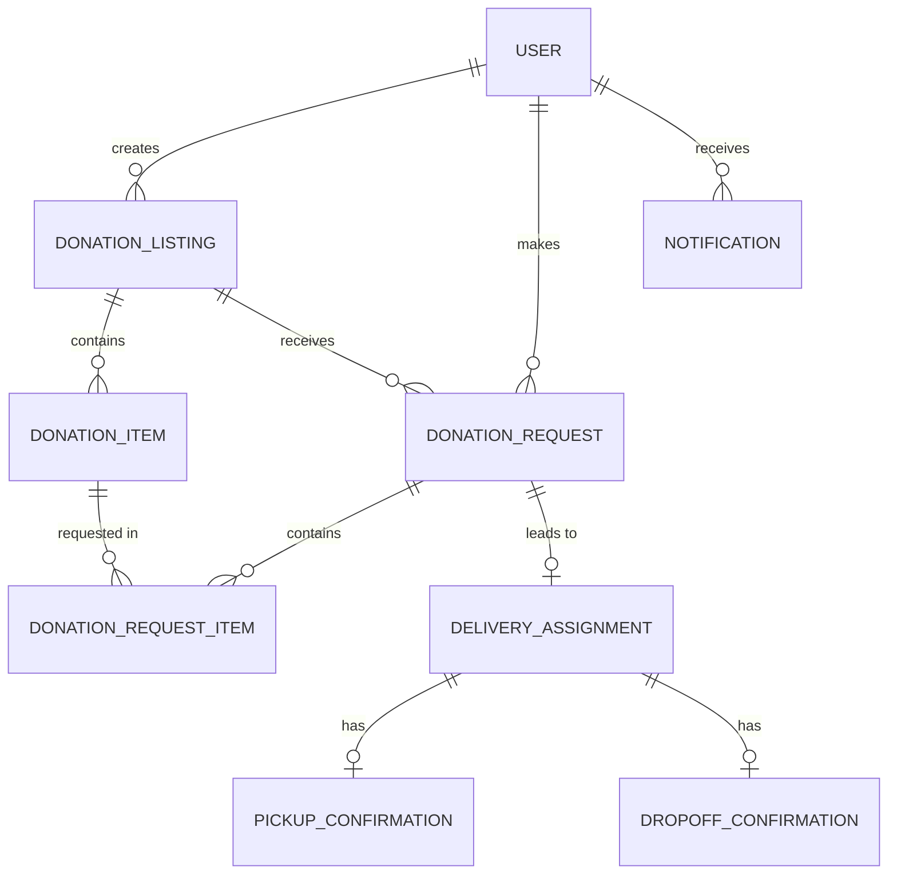

# EatMe: Database Design

> Status: to be completed in Sprint 0. Once the Prisma schema exists at `server/prisma/schema.prisma`, that file becomes the source of truth and this document explains it.

---

## Core Entities

```
User
DonationListing
DonationItem
DonationRequest
DonationRequestItem
DeliveryAssignment
PickupConfirmation
DropoffConfirmation
Notification
```

---

## ER Diagram

<!-- Insert the ERD image here, or use a Mermaid diagram so it renders on GitHub. -->



---

## Table Specifications

<!-- One table per entity: column, type, constraints, notes. -->

### User

| Column | Type | Notes |
|---|---|---|
| id | PK | |
| name | varchar | |
| email | varchar | Unique, login |
| password_hash | varchar | |
| role | enum | admin, coordinator, donor, recipient, driver |
| phone | varchar | |
| address | text | |
| status | enum | active, inactive |
| created_at | datetime | |

<!-- Remaining tables to be added. -->

---

## Enumerations

| Enum | Values |
|---|---|
| user.role | admin, coordinator, donor, recipient, driver |
| user.status | active, inactive |
| listing.status | open, partially_claimed, fully_claimed, expired, cancelled |
| item.category | packaged, prepared |
| item.storage_type | ambient, chilled, frozen |
| request.status | pending, accepted, rejected, cancelled |
| assignment.status | pending_driver, accepted, declined, in_transit, completed, cancelled |

---

## Expiry and Urgency Rules

**Packaged food.** Urgency is derived from `expiry_date` and the number of days remaining.

**Prepared food.** `computed_expiry = prepared_at + safe_window_hours`. Prepared items are treated as urgent by default because their safe window is short.

<!-- Record the exact thresholds the team agrees, for example: is_urgent = true when computed_expiry is within 12 hours. -->
