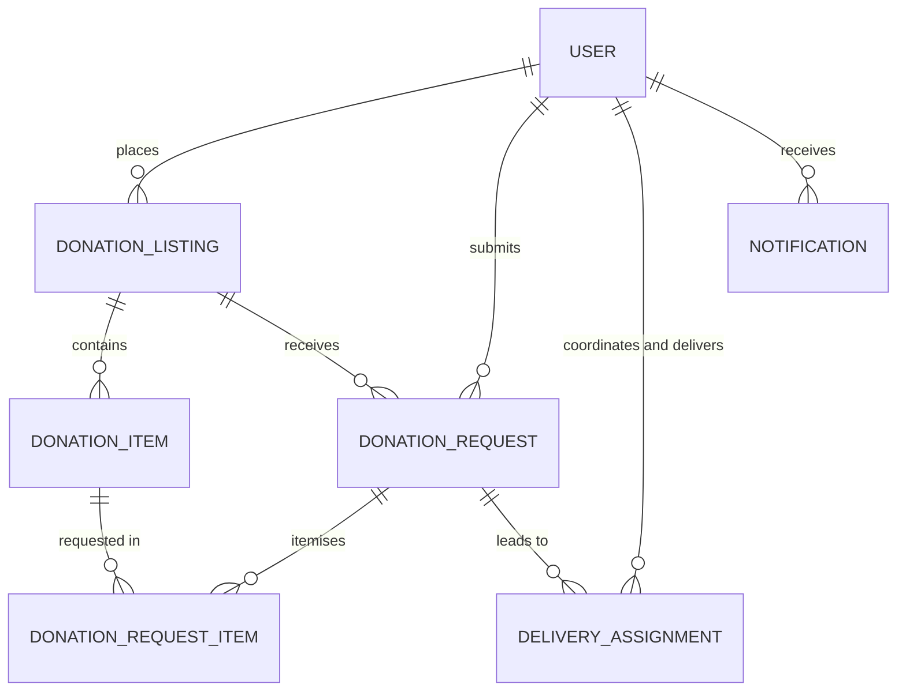

# EatMe: Database Design

> **Status:** implemented. `server/prisma/schema.prisma` now exists and is the source of truth; this document explains it. If the two disagree, the schema file wins.
>
> **Database is PostgreSQL 14 or later**, not MySQL. The change was made before any migration had been applied, so it cost nothing but the wording in this document. The reasoning is in charter section 7 and in section 10 below.

---

## 1. ER Diagram

The editable source is `diagrams/EatMe_ERD.drawio`. Open it at [app.diagrams.net](https://app.diagrams.net) via File, then Open From, then Device.

The diagram below is the same model in Mermaid, kept in this file so it renders on GitHub without needing an image export. If the two ever disagree, the `.drawio` file wins.

Notation in the `.drawio` file is crow's foot. A fork means *many*, a single bar means *one*.

For the report, export a PNG from draw.io with File, then Export as, then PNG. Exports are not committed, because a stale export that disagrees with the source is worse than no export at all.

---

## 2. Core Entities

Seven tables in four groups.

| Group | Tables |
|---|---|
| Identity and access | `User` |
| Donation and listing | `DonationListing`, `DonationItem` |
| Requests | `DonationRequest`, `DonationRequestItem` |
| Delivery and system | `DeliveryAssignment`, `Notification` |

Seven is the count already stated in `README.md` and in charter section 7.

### Relationships

| From | To | Cardinality | Meaning |
|---|---|---|---|
| `User` | `DonationListing` | 1 : N | a donor places many listings |
| `DonationListing` | `DonationItem` | 1 : N | a listing contains many food items |
| `User` | `DonationRequest` | 1 : N | a recipient submits many requests |
| `DonationListing` | `DonationRequest` | 1 : N | a listing receives many requests |
| `DonationRequest` | `DonationRequestItem` | 1 : N | a request itemises which items it wants |
| `DonationItem` | `DonationRequestItem` | 1 : N | an item can be requested by many recipients |
| `DonationRequest` | `DeliveryAssignment` | 1 : N | see the note on declines below |
| `User` | `DeliveryAssignment` | 1 : N | as coordinator, and separately as driver |
| `User` | `Notification` | 1 : N | |

**Why `DonationRequest` to `DeliveryAssignment` is 1:N and not 1:1.** When a driver declines, a **new** assignment row is inserted rather than the old one being overwritten, so the decline and its reason survive in the history. One accepted request can therefore accumulate several assignment rows over time. Only one of them will ever reach `completed`.

**Why `DonationRequestItem` exists.** A recipient does not request a whole listing, they request specific items in specific quantities. A hotel listing might hold rice, bread and milk powder; an elders' home may want only the rice. Without this junction table there is nowhere to store *how much of which item* was requested.

**Why there are no separate confirmation tables.** An earlier draft had `PickupConfirmation` and `DropoffConfirmation` as their own entities. Both were strictly 1:1 with `DeliveryAssignment`, enforced by a unique key on `assignment_id`, which is the textbook signal that they belong in the parent row. Folding them in removes two tables, two joins and four redundant boolean columns, because a nullable timestamp already records both whether a confirmation happened and when. The one thing that would have justified separate entities, photographic proof of handover, is explicitly out of scope in charter section 4.2.

---

## 3. Table Specifications

### 3.1 User

| Column | Type | Key | Null | Notes |
|---|---|---|---|---|
| `user_id` | SERIAL | PK | No | |
| `name` | VARCHAR(100) | | No | Person or organisation contact name |
| `email` | VARCHAR(150) | UK | No | Login identifier |
| `password_hash` | VARCHAR(255) | | No | bcryptjs hash, never the plain password |
| `phone` | VARCHAR(20) | | No | |
| `address` | TEXT | | No | Pickup or delivery address depending on role |
| `role` | ENUM | | No | `admin`, `coordinator`, `donor`, `recipient`, `driver` |
| `organisation_name` | VARCHAR(150) | | Yes | Only for donors and recipients acting as organisations |
| `is_available` | BOOLEAN | | No | Default `true`. Drivers in practice; the coordinator filters on it when assigning a delivery |
| `status` | ENUM | | No | `active`, `inactive`. Admin suspension sets `inactive` |
| `created_at` | TIMESTAMPTZ | | No | |
| `updated_at` | TIMESTAMPTZ | | No | |

One table holds all five roles. Separate tables per role were rejected because every role shares the same login, contact and address fields, and a single table keeps the auth middleware simple.

`is_verified` was removed from an earlier draft. No user story, endpoint or screen in the backlog uses it, and a column nothing reads is a column nobody can explain at the viva.

### 3.2 DonationListing

| Column | Type | Key | Null | Notes |
|---|---|---|---|---|
| `listing_id` | SERIAL | PK | No | |
| `donor_id` | INT | FK → `User.user_id` | No | |
| `title` | VARCHAR(150) | | No | |
| `description` | TEXT | | Yes | |
| `pickup_address` | VARCHAR(255) | | No | May differ from the donor's registered address |
| `pickup_window_start` | TIMESTAMPTZ | | No | |
| `pickup_window_end` | TIMESTAMPTZ | | No | |
| `status` | ENUM | | No | `open`, `partially_claimed`, `fully_claimed`, `expired`, `cancelled` |
| `created_at` | TIMESTAMPTZ | | No | |
| `updated_at` | TIMESTAMPTZ | | No | |

A listing is a container. It carries no food attributes of its own; those live on `DonationItem`.

### 3.3 DonationItem

| Column | Type | Key | Null | Notes |
|---|---|---|---|---|
| `item_id` | SERIAL | PK | No | |
| `listing_id` | INT | FK → `DonationListing.listing_id` | No | |
| `food_name` | VARCHAR(120) | | No | |
| `category` | ENUM | | No | `packaged`, `prepared` |
| `quantity` | DECIMAL(8,2) | | No | Quantity originally offered |
| `quantity_remaining` | DECIMAL(8,2) | | No | Decrements as requests are accepted |
| `unit` | ENUM | | No | `kg`, `servings`, `loaves`, `packets`, `cans`, `litres` |
| `storage_type` | ENUM | | No | `ambient`, `chilled`, `frozen` |
| `expiry_date` | TIMESTAMPTZ | | Yes | **Packaged only.** Entered by the donor |
| `prepared_at` | TIMESTAMPTZ | | Yes | **Prepared only.** When the food was cooked |
| `safe_window_hours` | INT | | Yes | **Prepared only.** How long it stays safe |
| `computed_expiry` | TIMESTAMPTZ | | Yes | **Prepared only.** `prepared_at + safe_window_hours` |
| `is_urgent` | BOOLEAN | | No | Stored, not computed. See section 5 |
| `created_at` | TIMESTAMPTZ | | No | |
| `updated_at` | TIMESTAMPTZ | | No | Items mutate as stock is claimed and urgency is rewritten |

**The conditional expiry fields are the most important rule in this schema.** A packaged item uses `expiry_date` and leaves the three prepared columns null. A prepared item leaves `expiry_date` null and uses the other three.

This is enforced in two places. `server/src/services/urgency.service.ts` checks it first and returns a message a donor can act on. PostgreSQL then enforces the same rule as a CHECK constraint, so an item that breaks it cannot be written even by a route that forgets to call the service. See section 10.

### 3.4 DonationRequest

| Column | Type | Key | Null | Notes |
|---|---|---|---|---|
| `request_id` | SERIAL | PK | No | |
| `listing_id` | INT | FK → `DonationListing.listing_id` | No | |
| `recipient_id` | INT | FK → `User.user_id` | No | |
| `message` | TEXT | | Yes | Optional note from recipient to donor |
| `status` | ENUM | | No | `pending`, `accepted`, `rejected`, `cancelled` |
| `rejection_reason` | TEXT | | Yes | Shown to the recipient when rejected |
| `responded_at` | TIMESTAMPTZ | | Yes | Set when the donor accepts or rejects |
| `created_at` | TIMESTAMPTZ | | No | |
| `updated_at` | TIMESTAMPTZ | | No | |

### 3.5 DonationRequestItem

| Column | Type | Key | Null | Notes |
|---|---|---|---|---|
| `request_item_id` | SERIAL | PK | No | |
| `request_id` | INT | FK → `DonationRequest.request_id` | No | |
| `item_id` | INT | FK → `DonationItem.item_id` | No | |
| `quantity_requested` | DECIMAL(8,2) | | No | Must be ≤ `DonationItem.quantity_remaining` |

**Constraint:** `UNIQUE (request_id, item_id)`. The same item cannot appear twice in one request.

### 3.6 DeliveryAssignment

| Column | Type | Key | Null | Notes |
|---|---|---|---|---|
| `assignment_id` | SERIAL | PK | No | |
| `request_id` | INT | FK → `DonationRequest.request_id` | No | |
| `coordinator_id` | INT | FK → `User.user_id` | No | Who created the assignment |
| `driver_id` | INT | FK → `User.user_id` | No | Who was asked to deliver |
| `status` | ENUM | | No | `pending_driver`, `accepted`, `declined`, `in_transit`, `completed`, `cancelled` |
| `note_to_driver` | TEXT | | Yes | |
| `decline_reason` | TEXT | | Yes | Populated when status becomes `declined` |
| `assigned_at` | TIMESTAMPTZ | | No | |
| `responded_at` | TIMESTAMPTZ | | Yes | When the driver accepted or declined |
| `pickup_donor_confirmed_at` | TIMESTAMPTZ | | Yes | Null until the donor confirms handover |
| `pickup_driver_confirmed_at` | TIMESTAMPTZ | | Yes | Null until the driver confirms collection |
| `pickup_notes` | TEXT | | Yes | |
| `dropoff_driver_confirmed_at` | TIMESTAMPTZ | | Yes | Null until the driver confirms delivery |
| `dropoff_recipient_confirmed_at` | TIMESTAMPTZ | | Yes | Null until the recipient confirms receipt |
| `dropoff_notes` | TEXT | | Yes | |
| `completed_at` | TIMESTAMPTZ | | Yes | |
| `created_at` | TIMESTAMPTZ | | No | |
| `updated_at` | TIMESTAMPTZ | | No | Assignments mutate through the whole delivery lifecycle |

Two foreign keys point at `User`, so the ORM relation needs explicit naming to disambiguate them.

**Both handovers are two-sided on purpose.** A handover is only trustworthy if both parties say it happened. The assignment moves to `in_transit` when both pickup timestamps are set, and to `completed` when both dropoff timestamps are set. A null timestamp means not yet confirmed, which is why no separate boolean flag is needed.

### 3.7 Notification

| Column | Type | Key | Null | Notes |
|---|---|---|---|---|
| `notification_id` | SERIAL | PK | No | |
| `user_id` | INT | FK → `User.user_id` | No | Recipient of the notification |
| `type` | ENUM | | No | See enumerations below |
| `title` | VARCHAR(150) | | No | |
| `body` | VARCHAR(255) | | No | |
| `related_entity_type` | VARCHAR(40) | | Yes | For example `listing`, `request`, `assignment` |
| `related_entity_id` | INT | | Yes | Deep link target |
| `is_read` | BOOLEAN | | No | Default `false` |
| `created_at` | TIMESTAMPTZ | | No | |

In-app only. Push notifications are deferred to Sprint 4.

---

## 4. Enumerations

Do not invent new values without updating this document.

| Enum | Values |
|---|---|
| `user.role` | `admin`, `coordinator`, `donor`, `recipient`, `driver` |
| `user.status` | `active`, `inactive` |
| `listing.status` | `open`, `partially_claimed`, `fully_claimed`, `expired`, `cancelled` |
| `item.category` | `packaged`, `prepared` |
| `item.unit` | `kg`, `servings`, `loaves`, `packets`, `cans`, `litres` |
| `item.storage_type` | `ambient`, `chilled`, `frozen` |
| `request.status` | `pending`, `accepted`, `rejected`, `cancelled` |
| `assignment.status` | `pending_driver`, `accepted`, `declined`, `in_transit`, `completed`, `cancelled` |
| `notification.type` | `new_request`, `request_accepted`, `request_rejected`, `driver_assigned`, `driver_declined`, `delivery_completed`, `food_urgent` |

---

## 5. Expiry and Urgency Rules

**Packaged food.** The donor enters `expiry_date` directly. Urgency derives from the days remaining.

**Prepared food.** `computed_expiry = prepared_at + safe_window_hours`. Prepared food is treated as urgent by default because its safe window is short.

**Agreed thresholds**, implemented in `server/src/services/urgency.service.ts`:

| Condition | Result |
|---|---|
| Expiry within 6 hours | critical, shown red in the app |
| `category = prepared` | always urgent, whatever the safe window |
| `category = packaged` and expiry within 48 hours | urgent, shown amber |
| Otherwise | not urgent, shown green |

The rules are applied in that order, so a prepared item that is also within 6 hours reads as critical rather than merely urgent.

`is_urgent` is a **stored column**, written whenever an item is created or updated, so browse can `ORDER BY is_urgent DESC, computed_expiry ASC` in SQL rather than sorting in memory after the query. The trade-off is that the flag ages: it is correct at write time, and a scheduled refresh is Sprint 4 work.

Browse results are ordered urgent first, then by soonest expiry. The composite index on `(is_urgent, computed_expiry)` serves that ordering directly.

---

## 6. Status Transitions

**Listing.** `open` → `partially_claimed` when some but not all item quantity is claimed → `fully_claimed` when every item reaches zero remaining. `expired` is set by a scheduled check once the pickup window passes. `cancelled` is set by the donor or by admin moderation and is a **soft cancel**: the row is never deleted.

**Request.** `pending` → `accepted` or `rejected` by the donor. The recipient may set `cancelled` while it is still pending.

**Assignment.** `pending_driver` → `accepted` → `in_transit` → `completed`. A `declined` row is terminal; the coordinator creates a fresh row to reassign.

---

## 7. Decisions

### Settled and implemented

1. **Urgency thresholds.** The table in section 5 is agreed: prepared always urgent, packaged urgent within 48 hours, anything within 6 hours critical.
2. **`is_urgent` is a stored column**, not computed at read time, so browse can order by it in SQL.
3. **`quantity_remaining` decrements on donor acceptance**, never on request creation. A pending request must not reserve stock, otherwise one recipient sitting on an unanswered request blocks everyone else. Implemented as `quantityAfterAcceptance()` in `urgency.service.ts`, and backed by the quantity range CHECK constraint in section 10.
4. **Driver availability** is modelled as `User.is_available`, defaulting to `true`. The coordinator filters on it when choosing a driver. A fuller `DriverProfile` with vehicle type and capacity was rejected as more than this project needs.
5. **Database is PostgreSQL**, not MySQL. See charter section 7 and section 10 below.

### Still open

6. **Soft cancel semantics.** Confirm that `DELETE /api/donations/:id` sets `status = cancelled` rather than removing the row, and agree whether admin moderation uses that same endpoint or `/api/admin/listings/:id`.
7. **Delivery assignment sprint.** `docs/02-product-backlog.md` and `docs/05-api-plan.md` place it in Sprint 2, `CLAUDE.md` places it in Sprint 3. Three documents currently disagree and one of them must change.
8. **Moderation is not audited.** Charter section 8 gives the administrator power to remove listings and manage user accounts, but nothing records who moderated what, when, or why. A `ModerationAction` table (actor, action, target entity, reason, timestamp) would close it at the cost of an extra entity. Accepting the gap is defensible for a project this size, provided it is a recorded decision rather than an oversight. **Naily's call, as the Administration module owner.**
9. **`is_urgent` goes stale.** It is correct when written but ages as time passes. A scheduled refresh, or recomputation on read, is Sprint 4 work and has no owner yet.

---

## 8. What is deliberately not modelled

Listing these stops the same questions being reopened every sprint.

| Not modelled | Why |
|---|---|
| Session or token table | JWTs are stateless, so there is no server-side session to store |
| Photographs of food or handover proof | Camera capture is out of scope, charter section 4.2 |
| Chat or messages between users | Out of scope, charter section 4.2. `DonationRequest.message` covers the one-line note a recipient sends |
| Ratings or feedback | Out of scope, not in any user story |
| A separate address table | Over-normalisation. One address per user and one pickup address per listing is all the workflow needs |
| Platform statistics table | `GET /api/admin/stats` is served by `COUNT` queries over the existing tables, not by a stored aggregate |
| Food category lookup table | `category`, `unit` and `storage_type` are fixed enums, not user-editable reference data |

---

## 9. Index Plan

| Table | Index | Reason |
|---|---|---|
| `User` | `email` (unique) | Login lookup |
| `DonationListing` | `donor_id`, `status` | Donor dashboard, browse filtering |
| `DonationItem` | `listing_id`, `(is_urgent, computed_expiry)`, `expiry_date` | Browse orders urgent first then soonest expiry; one composite index serves that whole `ORDER BY` |
| `DonationRequest` | `listing_id`, `recipient_id`, `status` | Donor inbox and recipient history |
| `DonationRequestItem` | `(request_id, item_id)` unique | Prevents duplicate items in one request |
| `DeliveryAssignment` | `request_id`, `(driver_id, status)`, `status`, `coordinator_id` | Driver dashboard and coordinator queue |
| `Notification` | `(user_id, is_read)` | Unread badge count |
| `User` | `(role, is_available)` | Coordinator picking a free driver |

---

## 10. Database Constraints

PostgreSQL enforces five rules that would otherwise live only in application code. Prisma cannot express `CHECK` constraints in `schema.prisma`, so they are written by hand at the end of the init migration. Editing a migration this way is a supported Prisma workflow: the shadow database replays the file, so `prisma migrate dev` still works and the constraints survive `prisma migrate reset`.

| Constraint | Table | Rule |
|---|---|---|
| `donation_items_packaged_expiry_check` | `DonationItem` | A packaged item has `expiry_date`, and `prepared_at` and `safe_window_hours` are both null |
| `donation_items_prepared_expiry_check` | `DonationItem` | A prepared item has `prepared_at` and a positive `safe_window_hours`, and `expiry_date` is null |
| `donation_items_quantity_range_check` | `DonationItem` | `quantity > 0`, and `0 <= quantity_remaining <= quantity` |
| `donation_request_items_quantity_positive_check` | `DonationRequestItem` | `quantity_requested > 0` |
| `donation_listings_pickup_window_check` | `DonationListing` | The pickup window ends after it starts |

**Why both a constraint and a service check.** `server/src/services/urgency.service.ts` validates the same rules first and returns a message a donor can act on, because a raw constraint violation is not something to show a user. The constraint is the backstop: it catches a route that forgets to call the service, a mistake in the seed script, or someone editing rows by hand in `psql`.

The quantity range constraint is also what makes the `quantity_remaining` decrement safe. Two donors accepting requests for the same item at the same moment cannot drive the remaining quantity below zero, because the database rejects the second write rather than silently oversubscribing the food.

**This was not possible on MySQL.** The conditional expiry rule is a conditional `NOT NULL`, which MySQL cannot express, so before the move to PostgreSQL it existed only in application code and any code path that skipped the service could write an item with no expiry at all.
